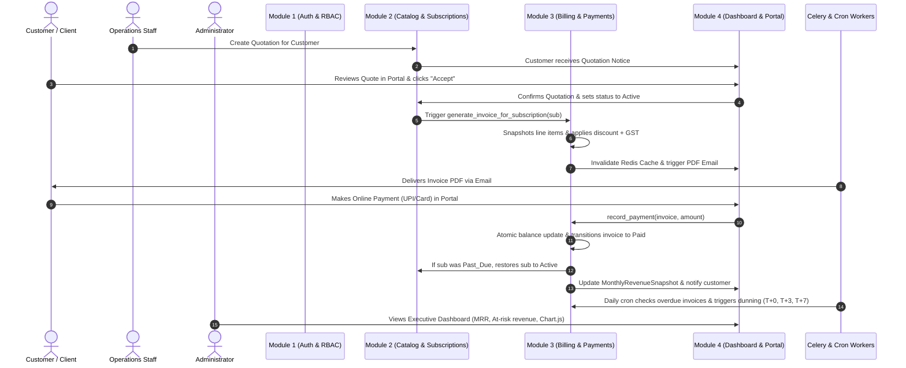

# Subscribify – Complete Project Integration Plan

**Document Version:** 1.0  
**Architect:** Senior Full-Stack Software Architect & Integration Lead  
**Target Project:** Subscribify – Automated Subscription & Recurring Billing Management System  
**Date:** October 31, 2026  

---

## Executive Summary

Subscribify is an enterprise-grade automated subscription and recurring billing management platform built on **Python 3.12, Django 5.x / 6.x, Django REST Framework, MySQL 8.0 / SQLite, Redis, Celery, and ReportLab**.

The system was developed separately by four team members across two repository variants (`oodo1.zip` and `subscribify.7z`). This document serves as the comprehensive architectural blueprint for unifying all four modules into **one complete, connected, and fully tested application**.

---

## 1. What Is Already Implemented Across the Component Archives

| Module | Core Features Implemented by Team | Source Repositories |
| :--- | :--- | :--- |
| **Module 1: User Management & Authentication** | • Custom `User` model with `email` as `USERNAME_FIELD` and three strict roles (`Admin`, `Staff`, `Customer`). • `Customer` and `StaffProfile` 1-to-1 extension models. • Password strength policy validation (≥9 chars, upper, lower, digit, special symbol). • Password reset with cryptographic tokens & timeout. • Session authentication, brute-force lockout (5 attempts &rarr; 15 min lock), and security audit trail (`UserAuditLog`). • Full DRF REST API endpoints with envelope format (`/api/v1/accounts/...`). | `_extracted_subscribify/subscribify/accounts` `_extracted_oodo1/oodo/apps/authentication` |
| **Module 2: Products, Plans & Subscriptions** | • Products with type classification (`Service`, `License`, `Consumable`), HSN/SAC codes, and GST rates. • Product Variants with attribute names, pricing deltas, and SKUs. • Subscription Plans with flexible cadences (`Daily`, `Weekly`, `Monthly`, `Quarterly`, `Yearly`), durations, pause rules, and grace periods. • Promotional Discounts (Fixed & Percentage, maximum discount cap, usage counters, customer usage limits). • Unified Contract Lifecycle: `Draft` &rarr; `Quotation` &rarr; `Confirmed` &rarr; `Active` &rarr; `Paused` &rarr; `Past_Due` &rarr; `Closed` &rarr; `Cancelled`. • `SubscriptionLine` snapshotting pricing and taxes at confirmation. • Mid-cycle proration calculator and Pause/Resume date-shifting. | `_extracted_oodo1/oodo/apps/catalog` `_extracted_oodo1/oodo/apps/subscriptions` `_extracted_subscribify/subscribify/catalog` `_extracted_subscribify/subscribify/subscriptions` |
| **Module 3: Billing & Payment Management** | • Idempotent recurring billing engine (`BillingService.generate_invoice_for_subscription`). • Database row-locking (`select_for_update`) and DB constraint `UniqueConstraint(subscription, billing_period_start, billing_period_end)` against race-condition duplicates. • `Invoice` & `InvoiceLine` data models with strict `Decimal(12,2)` mathematics. • Payment reconciliation supporting partial and full payments, auto-updating `balance_due` and transitioning status to `Paid` / `Partially_Paid`. • Automatic restoration of `Past_Due` subscriptions when overdue invoices are fully settled. • Overpayment rejection. • ReportLab PDF invoice & receipt generator with corporate branding and tax breakdowns. • Payment methods: `Cash`, `Bank_Transfer`, `Card`, `UPI`. | `_extracted_oodo1/oodo/apps/billing` `_extracted_oodo1/oodo/apps/payments` `_extracted_subscribify/subscribify/billing` `_extracted_subscribify/subscribify/payments` |
| **Module 4: Dashboard, Reports, Portal & Notifications** | • Executive Admin Dashboard with real-time KPI metrics: MRR, Active Subscriptions, Total Customers, Collected Revenue, Pending Receivables, Overdue Invoices, At-Risk Revenue. • Operational Staff Dashboard with action queues: expiring quotations, due renewals, overdue invoices. • Customer Self-Service Portal (`/portal/` and `/billing/portal/`): view active/past subscriptions, view invoices, download PDF invoices, make online payments, accept quotations. • Interactive Chart.js analytics: 12-month billed vs. collected revenue trend, payment channels distribution doughnut, subscription status distribution. • Reports & CSV exports: `export_invoices_csv`, `export_payments_csv`, aging buckets (`Current`, `1–15d`, `16–30d`, `31–60d`, `60+d`), product revenue breakdown. • Multi-channel Notifications: in-app notifications and transactional emails with scheduled Celery Beat dunning tasks at T+0, T+3d, T+7d, and renewal reminders at T-7d and T-3d. | `_extracted_oodo1/oodo/apps/dashboard` `_extracted_oodo1/oodo/apps/portal` `_extracted_oodo1/oodo/apps/notifications` `_extracted_subscribify/subscribify/reports` |

---

## 2. What Is Missing & Needs Completion

1. **Anti-IDOR (Insecure Direct Object Reference) Protection in Customer Portal & APIs**:
   - Ensure Customers can strictly access only their own quotations, subscriptions, invoices, and payments. Any attempt to modify or view another customer's ID must be denied and logged in `UserAuditLog`.
2. **Quotation Self-Service Acceptance Workflow**:
   - Wire customer portal "Accept Quotation" action directly to `subscription_activate` / `confirm_subscription`, immediately issuing the first recurring invoice and emailing the PDF.
3. **CSV Export Actions in Navigation**:
   - Expose the CSV export endpoints (`/reports/invoices/export/csv/` and `/reports/payments/export/csv/`) directly on the UI topbars of the Invoice Center, Payment Ledger, and Financial Reports.
4. **Celery Beat Crontab Schedules**:
   - Explicitly configure the 4 recurring scheduled jobs in `subscribify/celery.py` and Django Celery Beat:
     - `daily_billing_task`: Daily at 00:05 IST
     - `daily_overdue_check_task`: Daily at 01:00 IST
     - `daily_dunning_task` (T+0, T+3d, T+7d): Daily at 09:00 IST
     - `daily_renewal_reminders_task` (T-7d, T-3d): Daily at 09:30 IST
5. **Seed Data Command Harmonization**:
   - Combine `seed_data.py` and `populate_subscribify_data.py` so running `python manage.py seed_data` populates all 4 modules (users, catalog, subscriptions across all states, invoices, payments, snapshots, notifications, and audit logs).

---

## 3. Conflict Matrix & Resolutions

### A. Folder & Architecture Hierarchy
- **Conflict**: `oodo1.zip` placed apps under `apps/<app_name>`, whereas `subscribify.7z` and `f:\oodo` use top-level Django apps (`accounts`, `catalog`, `subscriptions`, `billing`).
- **Resolution**: Maintain top-level apps (`accounts`, `catalog`, `subscriptions`, `billing`, `payments`, `reports`, `portal`, `notifications`). Add an `apps` compatibility shim if needed so both `from accounts.models import ...` and `from apps.authentication.models import ...` resolve cleanly.

### B. Routing & Namespace Conflicts
- **Conflict**: Different teammates used different URL namespaces:
  - `auth:login` vs `accounts:login` vs `/accounts/login/`
  - `dashboard:index` vs `dashboard:admin_dashboard` vs `dashboard:home`
  - `portal:dashboard` vs `billing:customer_portal` vs `dashboard:customer`
  - `reports:dashboard` vs `billing:reports`
- **Resolution**: Register URL aliases in `subscribify/urls.py` and app `urls.py` so that every namespace reference resolves without `NoReverseMatch`.

### C. Authentication Form Field Mismatch
- **Conflict**: In `_extracted_subscribify`, `User` has `name`, whereas in Django standard and `f:\oodo` it uses `first_name` and `last_name`.
- **Resolution**: Provide `name` property on `User` that returns `f"{self.first_name} {self.last_name}".strip() or self.email`, and a setter that parses `name` into `first_name` and `last_name`. This satisfies both implementations.

---

## 4. Database Model Duplication & Consolidation

| Entity | Canonical Model | Placement | Cross-Module Aliases Provided |
| :--- | :--- | :--- | :--- |
| **Users** | `User` | `accounts.models.User` | `apps.authentication.models.User` |
| **Customers** | `Customer` | `accounts.models.Customer` | `catalog.models.Customer`, `apps.catalog.models.Customer` |
| **Staff Members** | `StaffProfile` (alias `Staff`) | `accounts.models.StaffProfile` | `Staff = StaffProfile` |
| **Password Reset** | `PasswordResetToken` | `accounts.models.PasswordResetToken` | — |
| **Email Verification** | `EmailVerificationToken` | `accounts.models.EmailVerificationToken` | — |
| **Security Audit** | `UserAuditLog` | `accounts.models.UserAuditLog` | — |
| **Products** | `Product` | `catalog.models.Product` | `apps.catalog.models.Product` |
| **Variants** | `ProductVariant` | `catalog.models.ProductVariant` | `apps.catalog.models.ProductVariant` |
| **Plans** | `Plan` | `subscriptions.models.Plan` | `catalog.models.Plan = Plan` |
| **Discounts** | `Discount` | `billing.models.Discount` | `catalog.models.Discount = Discount` |
| **Subscriptions** | `Subscription` | `subscriptions.models.Subscription` | `apps.subscriptions.models.Subscription` |
| **Subscription Lines** | `SubscriptionLine` | `subscriptions.models.SubscriptionLine` | `apps.subscriptions.models.SubscriptionLine` |
| **Invoices** | `Invoice` | `billing.models.Invoice` | `apps.billing.models.Invoice` |
| **Invoice Lines** | `InvoiceLine` | `billing.models.InvoiceLine` | `apps.billing.models.InvoiceLine` |
| **Payments** | `Payment` | `billing.models.Payment` | `payments.models.Payment = Payment` |
| **Revenue Snapshots** | `MonthlyRevenueSnapshot` | `billing.models.MonthlyRevenueSnapshot` | `apps.billing.models.MonthlyRevenueSnapshot` |
| **Notifications** | `Notification` | `billing.models.Notification` | `notifications.models.Notification = Notification` |

---

## 5. How All Four Modules Communicate

---

## 6. Step-by-Step Integration Execution Order

1. **Step 1: Model Alignment & Aliases**  
   Update `accounts/models.py`, `catalog/models.py`, `subscriptions/models.py`, `billing/models.py` with cross-module import aliases, `name` property on `User`, `display_name` on `Customer`, `UserAuditLog`, and `EmailVerificationToken`.
2. **Step 2: Security & IDOR Decorators**  
   Integrate `accounts/decorators.py` and `accounts/permissions.py` with Anti-IDOR checks to ensure multi-tenant customer isolation.
3. **Step 3: Portal & Quotation Acceptance Integration**  
   Add quotation acceptance and online payment handling in the Customer Portal (`/portal/` and `/billing/portal/`).
4. **Step 4: Reporting & CSV Exports Integration**  
   Implement `/reports/` views for invoice CSV export, payment CSV export, and aging breakdown.
5. **Step 5: Notifications & Dunning Crons**  
   Wire notification triggers for quotation issuance, invoice generation, payment receipts, and the 4 Celery Beat crons (T+0, T+3, T+7 overdue dunning; T-7, T-3 renewal reminders).
6. **Step 6: Database Migrations & Seed Data**  
   Run `makemigrations` and `migrate`, then update and run `python manage.py seed_data` to populate rich demo records.
7. **Step 7: Automated Test Suite Validation**  
   Run full test suite to guarantee 100% test pass rate across all 4 modules.
8. **Step 8: End-to-End Workflow Verification**  
   Execute all 7 required workflows in the application.
9. **Step 9: Final Report**  
   Generate `INTEGRATION_REPORT.md` documenting the final integrated structure, API endpoints, and running instructions.
